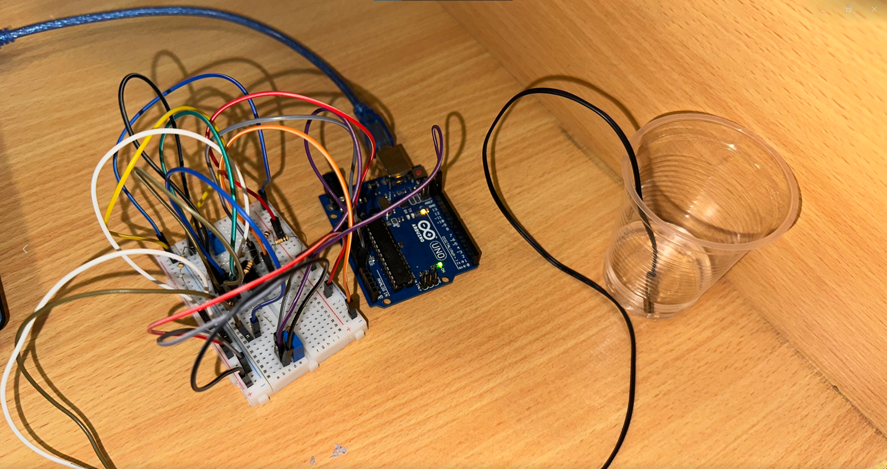

# Arduino NTC Temperature Measurement

A measurement systems laboratory project by **Pouya Asghari and Amir Mehdi Golchin**, combining NTC thermistor calibration, MATLAB curve fitting, an LM324 differential circuit, and Arduino temperature acquisition.



## Objective

Calibrate an NTC thermistor from measured resistance–temperature data and implement a digital temperature measurement system with analog signal conditioning and serial output.

## Methods

- Seven calibration measurements spanning 3–70 °C.
- Beta-model curve fitting in MATLAB using Curve Fitting Toolbox.
- Voltage-divider sensing and buffered differential subtraction using an LM324.
- An external ADC reference setting proposed at 3.49 V.
- Arduino acquisition at a nominal 5 Hz using TimerOne, with voltage, resistance, and temperature printed to the Serial Monitor.

## Reported calibration results

| Parameter | Reported value |
| --- | ---: |
| Beta coefficient | 3891.5751 K |
| Reference resistance at 25 °C | 9953.4133 Ω |
| Coefficient of determination | 0.9995 |
| Rounded firmware coefficients | B = 3892 K; R0 = 9953 Ω |

These values are transcribed from the original report, not independently reproduced. The fit statistic does not establish absolute temperature measurement accuracy.

## Files

| Path | Contents |
| --- | --- |
| [report/main.pdf](report/main.pdf) | English translation, code listings, and editorial review |
| [report/main.tex](report/main.tex) | Editable LaTeX source |
| `report/figures/` | Original report figures and cover logos |
| [report/BUILD.md](report/BUILD.md) | Compilation instructions |
| [arduino/Calibration/Calibration.ino](arduino/Calibration/Calibration.ino) | Original calibration sketch |
| [arduino/sketch_feb15a/sketch_feb15a.ino](arduino/sketch_feb15a/sketch_feb15a.ino) | Original temperature measurement sketch |
| [matlab/Assignment6.mlx](matlab/Assignment6.mlx) | Original MATLAB Live Script |
| [matlab/calibrate_ntc.m](matlab/calibrate_ntc.m) | MATLAB code extracted from the Live Script |
| `matlab/R-T.png`, `matlab/V-T.png` | Original standalone calibration plots |
| [docs/RUNNING.md](docs/RUNNING.md) | Requirements, workflow, and known issues |

The original archive contains a demonstration video of approximately 48.5 MiB. It is not required for the report and is excluded from this package so the remaining files can be uploaded through GitHub's browser interface. It remains available in the original archive. No native Fritzing file was supplied.

## Requirements and use

- MATLAB with Curve Fitting Toolbox for `fit`, `fittype`, and `fitoptions`.
- Arduino IDE, the board support package for your actual hardware, and a compatible TimerOne library for the measurement sketch.
- NTC thermistor, LM324, resistors, potentiometers, and the circuit described in the report.

Open `matlab/Assignment6.mlx` in MATLAB, or run `calibrate_ntc` from the `matlab` folder. Open each `.ino` from its matching folder in Arduino IDE. The supplied sketches use Serial Monitor at 9600 baud. Review the issues below before hardware use; the original files have not been compiled or tested during preparation of this repository.

## Technical review status

The original files are retained unchanged. The calibration sketch uses a resistance denominator of `V_NTC - Vcc`, which gives negative resistance for voltages between ground and supply. For the stated divider, the correct algebraic denominator is `Vcc - V_NTC`. Reconcile the reported positive measurements with the original acquisition procedure before treating this as verified calibration code.

The report also describes the output of the fourth LM324 amplifier as pin 1; the depicted 14-pin package uses pin 14 for that output. Verify the actual wiring and board-specific external AREF requirements before applying the circuit. The interrupt-shared ADC variable and its access also require review for the selected target.

The English report includes separate editorial notes for these issues. No corrected, hardware-tested implementation or temperature accuracy claim is supplied.

## Build the report

Upload the complete ZIP to Overleaf, select `report/main.tex`, and use pdfLaTeX. Keep the sibling `arduino/` and `matlab/` folders: the report imports their code listings.

Locally, run from the repository root:

```bash
cd report
pdflatex -interaction=nonstopmode -halt-on-error main.tex
pdflatex -interaction=nonstopmode -halt-on-error main.tex
```

All fonts and packages are standard LaTeX dependencies. No custom font or bibliography database is required.

## Academic context and attribution

Measurement Systems and Laboratory, Session Six, Group 15, School of Mechanical Engineering, College of Engineering, University of Tehran, first semester of academic year 1404–1405 (Iranian calendar).

The Persian source credits Pouya Asghari and امیرمهدی گلچین, transliterated here as Amir Mehdi Golchin. Individual contributions are not specified. Confirm the preferred English spelling when publishing.

English translation, LaTeX conversion, repository documentation, and editorial review were prepared with AI assistance. Original images and native Arduino/MATLAB files are preserved. The `.m` file is an extracted text version of the Live Script, not an independently rewritten algorithm.

## License

No license has been selected. Add one after the authors decide the intended reuse permissions. Third-party figures and documentation retain their original attribution.
